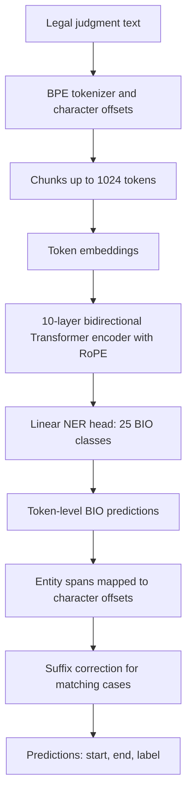

# Phase 2: Legal Named Entity Recognition (LNER)

In Phase 2, I worked on finding named entities in Indian legal judgments. The task is to predict the **entity type and its exact character span** in the document. I used the BPE tokenizer from Phase 1 and compared different Transformer models for token-level tagging.

## 1. Dataset and preprocessing

I used the `Phase_2_LNER` data from the [CS781 Capstone dataset](https://huggingface.co/datasets/Exploration-Lab/CS-781-Capstone). The notebooks use:

- `Train/fold1-text.json` and `Train/fold1-gold.json`
- `Train/fold2-text.json` and `Train/fold2-gold.json`
- The third text fold for test prediction.

The two training folds contain **70 documents** (35 in each fold), and the test fold contains **35 documents**. There are **12 entity categories**: `APP`, `RESP`, `A.COUNSEL`, `R.COUNSEL`, `JUDGE`, `WIT`, `AUTH`, `COURT`, `STAT`, `PREC`, `DATE`, and `CASENO`.

I converted character-level annotations to BIO token labels. With the outside (`O`) tag, the model predicts **25 token classes**. The preprocessing preserves token offsets so I can convert predicted token spans back to original document positions.

The token-alignment checks showed that some entity spans include extra punctuation in the tokenized text. I added a suffix correction map for consistent cases. One inspection found **1,417 unique mappings** and evaluated **2,239 suffix mismatches**; those figures describe preprocessing alignment checks, not the model's final prediction accuracy.

I randomly split the 70 labeled documents into **63 training documents** and **7 validation documents** using seed 42. Documents were divided into non-overlapping chunks of up to **1,024 tokens**; the saved output shows **455 training chunks** and **64 validation chunks**.

## 2. Models I tried

| Notebook | Experiment |
| --- | --- |
| `hybrid-model-2 (2).ipynb` | RoPE Transformer encoder and token-classification head, with additional LoRA/LoRMA implementations available in the notebook |
| `phase2-mha (2).ipynb` | Phase 1 MHA–RoPE decoder with LoRMA and partial fine-tuning for NER |
| `encoder-decoder-p2.ipynb` | Encoder–decoder experiment with LoRMA-based NER adaptation |
| `kernel-phase2.ipynb` | Kernel-attention decoder experiment with LoRMA and partial fine-tuning |

The notebooks have different active model configurations, so their validation scores should not be treated as a controlled single-variable comparison.

## 3. Architecture and implementation

The best **saved validation score in this uploaded folder** is from `hybrid-model-2 (2).ipynb`. Its active run uses a **bidirectional Transformer encoder with RoPE** and a linear NER classification head. This is the architecture used by the executed training cells, even though the notebook also defines LoRA and LoRMA classes for other experiments.

### Active configuration in `hybrid-model-2 (2).ipynb`

| Setting | Value |
| --- | --- |
| Backbone | Transformer encoder with RoPE |
| Layers | 10 |
| Hidden dimension | 512 |
| Attention heads / KV heads | 8 / 8 |
| Feed-forward dimension | 4,096 |
| Sequence length | 1,024 |
| Dropout | 0.1 |
| Classification head | Linear, 512 → 25 BIO classes |
| Total / trainable parameters in saved output | 56,605,209 / 56,605,209 |
| Initialization | Loads `hybrid_encoder.pt` from an external Kaggle dataset |

The active run fine-tunes the encoder and token head together. The **LoRA / partial fine-tuning classes defined elsewhere in the notebook are not the active model in its saved execution**.

## 4. Training approach

I used a weighted token-level cross-entropy loss with padded labels ignored using `ignore_index=-100`. Entity classes and `B-` tags were reweighted to reduce the effect of the frequent `O` label.

The saved encoder run used **AdamW**, learning rate **`1e-5`**, weight decay **`0.01`**, and an initial training schedule of **30 epochs** with patience 5. It then ran another **15-epoch** training call. The training function includes early stopping, gradient clipping, mixed precision, and a `ReduceLROnPlateau` scheduler. The notebook ran with **two Tesla T4 GPUs** using `torch.nn.DataParallel`.

At inference, I predict BIO tags for each chunk, combine them across the document, reconstruct entity spans using saved character offsets, and export a JSON file with `[start, end, label]` entries. The notebook packages `prediction.json` into `submission.zip`.

## 5. Results

The active encoder + NER head in `hybrid-model-2 (2).ipynb` reached **0.6706 validation token-level Macro-F1** in its second recorded training call, with validation Micro-F1 **0.9695**. These are **token-level validation metrics**, not Codabench's strict entity-level result.

My **recorded best official Phase 2 Codabench submission** used a Hybrid LoRA adaptation with partial fine-tuning:

| Official Phase 2 result | Value |
| --- | --- |
| Best reported model | Hybrid LoRA + partial fine-tuning |
| Codabench strict entity-level Macro-F1 | **0.415849** |
| Submission ID | `976447` |
| Recorded rank | **98** |

**Important notebook-to-submission distinction:** The exact executed code that produced submission `976447` cannot be confirmed from the four notebooks in this ZIP. In particular, the active training cell in `hybrid-model-2 (2).ipynb` constructs `NERHead(...)`, not the reported winning Hybrid LoRA partial-fine-tuning model. Do not present its saved validation score as the official winning submission's score. The winning notebook should be added to the final `code/phase2/` submission folder once matched to the submitted run.

## 6. How to run the notebooks

These notebooks were run in **Kaggle**. They contain Kaggle input paths and use external data files, tokenizer artifacts, and pretrained weights. The original weights are not included in this code ZIP, following the submission instructions.

1. Open the chosen `.ipynb` file in Kaggle and enable a GPU runtime. Install any missing packages.
2. Make the CS781 Phase 2 JSON data available as a Kaggle dataset. The notebooks also use Hugging Face authentication through Kaggle Secrets (`HF`) in the initial cells.
3. Attach the Phase 1 BPE tokenizer file expected at the hard-coded `project_bpe_16k.pkl` path. The saved tokenizer output reports a vocabulary of **7,999** entries.
4. Attach the appropriate pretrained model checkpoint at its input path. For the active `hybrid-model-2 (2).ipynb` run, the code reads `hybrid_encoder.pt` from `/kaggle/input/datasets/rogue2222/hybrid1b/`.
5. Update the hard-coded input and output paths for your own Kaggle datasets. Run data loading, alignment, label preparation, chunking, model setup, and training cells in order.
6. Run the inference cells to generate `prediction.json`, then create `submission.zip` using the last cells.

**A fully independent rerun is not possible from this folder alone:** the data, tokenizer, and pretrained initialization weights are external. Do not upload those model weights or checkpoints with the final assignment archive.

## 7. Files in this folder

- `hybrid-model-2 (2).ipynb` — encoder and NER head experiment; strongest saved validation result among this folder's active runs.
- `phase2-mha (2).ipynb` — MHA–RoPE decoder and LoRMA partial fine-tuning experiment.
- `encoder-decoder-p2.ipynb` — encoder–decoder NER experiment.
- `kernel-phase2.ipynb` — kernel-attention NER experiment.

