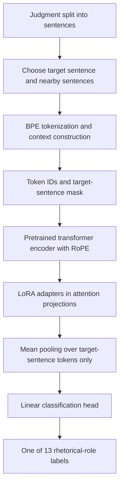

# Phase 3 — Rhetorical Role Classification

In Phase 3, I worked on assigning a **rhetorical role to each sentence in a legal judgment**. The label describes what the sentence is doing in the judgment, for example stating facts, discussing an issue, citing a precedent or giving the court's ruling.

I tried different pretrained model families and fine-tuning methods. My best official Phase 3 result was from a **hybrid encoder with LoRA-based adaptation and two-stage training**. The main code for this approach is in **`phase3hybrid (2).ipynb`**.

## 1. Model architecture

The classifier uses a pretrained transformer encoder and a classification head. I feed the target sentence together with a limited number of nearby sentences because the role of a sentence often depends on its context.

For the main notebook, the instantiated backbone has **10 transformer encoder layers**, hidden dimension **512**, **8 attention heads**, feed-forward dimension **4096**, and maximum sequence length **1024**. The model is initialized from an external pretrained hybrid-encoder checkpoint. Although some configuration constants at the beginning of the notebook say `MODEL_LAYERS = 12`, the actual model construction uses `n_layers=10`.

The active classifier in `phase3hybrid (2).ipynb` uses:

- **LoRA** on the `q_proj`, `k_proj`, `v_proj` and `o_proj` attention projections.
- LoRA rank **32**, alpha **64**, and adapter dropout **0.1**.
- Partial backbone fine-tuning, configured with `unfreeze_last_n=1`.
- A linear classification head with **13 output labels**; head dropout is **0.2**.
- Target-only token pooling rather than averaging the surrounding context into the final sentence representation.

The notebook defines additional model classes for other methods, but the above describes the instantiated classifier for the main run.

## 2. Dataset and preprocessing

I used the **Phase 3 rhetorical-role** data from `Exploration-Lab/CS-781-Capstone` on Hugging Face. The notebook loads the **CL** and **IT** train/development files, the corresponding test files, and `label_vocab.json`.

1. Read each judgment as an ordered sequence of sentences and labels.
2. Encode the sentences using the BPE tokenizer saved from the earlier work.
3. For every target sentence, collect up to **5 preceding and 5 following sentences** from the *same document*.
4. Keep the target sentence and fit the surrounding context into a maximum of **1024 tokens**. Neighboring sentences are separated using the configured separator token.
5. Build a Boolean mask indicating which tokens belong to the **target sentence**. Only those representations are pooled for classification.
6. Preserve the original document and sentence order when generating predictions.

The 13 labels are `Fact`, `Issue`, `ArgumentPetitioner`, `ArgumentRespondent`, `Statute`, `Dissent`, `PrecedentReliedUpon`, `PrecedentNotReliedUpon`, `PrecedentOverruled`, `RulingByLowerCourt`, `RatioOfTheDecision`, `RulingByPresentCourt`, and `None`.

## 3. Methodology and training

The main experiment in `phase3hybrid (2).ipynb` trains the same classifier in two stages:

**Stage 1 — CL + IT:** I combine both domains for training and validation. The notebook uses AdamW with learning rates **5e-4** for trainable encoder/adaptation parameters and **1e-3** for the classification head. The loss is weighted cross-entropy with **0.05 label smoothing**; class weights use the inverse fourth root of each class frequency. Batch size is **16**, and training uses early stopping with patience **4** (up to **30** epochs).

**Stage 2 — CL fine-tuning:** I continue using the trained classifier but train on **CL** data, with CL development data for validation. The second-stage optimizer uses learning rates **1e-5** for the trainable encoder/adaptation parameters and **3e-5** for the head, with the same early-stopping setup. This is not a fresh model trained from scratch.

The notebook sets random seed **42** and supports CUDA, including multiple GPUs if present. The main evaluation metric tracked during training is **macro-F1**; micro-F1 is also printed.

## 4. Results

| Evaluation | Result |
|---|---:|
| Stage 1 best validation macro-F1 (CL + IT development) | **0.3795** |
| Stage 2 best validation macro-F1 (CL development) | **0.3268** |
| Best official Phase 3 Codabench macro-F1 | **0.478979** |
| Official best submission ID | **991284** |
| Recorded leaderboard rank | **79** |

The first two values are the validation results printed by `phase3hybrid (2).ipynb`; they are **not** Codabench test scores. The official score is taken from my Phase 3 submission record. This archive does not include a submission-to-notebook manifest proving the precise notebook revision used for submission **991284**, so the notebook is identified as the main two-stage implementation rather than independently verified as that exact submitted revision.

## 5. Other experiments in this folder

| Notebook | What I tested |
|---|---|
| `phase3hybrid (2).ipynb` | Main hybrid encoder experiment, LoRA + partial fine-tuning, CL+IT then CL training |
| `hybrid-phase3-lorma (1).ipynb` | Hybrid-encoder adapter experiment; the active model is a **LoRA** classifier even though the filename mentions LoRMA |
| `mha-decoder-phase3 (1).ipynb` | Decoder-based classifier with LoRA |
| `encoder-decoder-phase3.ipynb` | Encoder–decoder model adapted for rhetorical-role classification |
| `knowledge-distillation.ipynb` | Teacher–student distillation experiment |
| `Phase3_Kernel_LoRA.ipynb` | Kernel LoRA-based rhetorical-role classifier |

These notebooks document comparisons. The main best-model implementation is the `phase3hybrid (2).ipynb` notebook.

## 6. Implementation details

The notebooks are written in **Python / PyTorch** and were developed for a **Kaggle notebook environment**. The implementation contains the transformer blocks, RoPE attention, LoRA layers, sentence-context dataset, padding collator, classifier, training/validation functions, prediction generation, and Codabench `prediction.json` ZIP packaging.

The main notebook retrieves source JSON files using `huggingface_hub`, loads a tokenizer using `pickle`, and loads a pretrained encoder checkpoint using `torch.load`. These **external inputs are not included in this ZIP**.

## 7. How to run

1. Open `phase3hybrid (2).ipynb` in Kaggle with GPU enabled.
2. Install or make available the imported packages, including **PyTorch, NumPy, pandas, scikit-learn, matplotlib, tqdm, and huggingface_hub**. Kaggle-specific modules such as `kaggle_secrets` are used for access to Hugging Face.
3. Provide the Hugging Face access token through a Kaggle secret named **`HF`** if authentication is required.
4. Make the following external files available and **update their paths** in the notebook for your environment:
   - The Phase 3 CL/IT training, development, testing, and label-vocabulary JSON files in `Exploration-Lab/CS-781-Capstone`.
   - The saved BPE tokenizer (`project_bpe_16k.pkl`).
   - The pretrained hybrid-encoder checkpoint (`hybrid_encoder.pt`) used to initialize the model.
5. Run the notebook cells **in order**. The first training stage uses CL+IT; the next stage fine-tunes on CL.
6. Inspect the printed validation macro-F1 and micro-F1. The prediction cells create `prediction.json`, and the last cells package it into `submission.zip`.

**Note:** The notebook contains Kaggle-specific `/kaggle/input/...` and `/kaggle/working/...` paths, including an output folder named `cs781_phase2` that is reused in Phase 3. Update paths as necessary. The provided notebook is not fully standalone without the tokenizer, the pretrained encoder checkpoint, and the dataset files. These prerequisites are documented here but **no trained weights or checkpoints are included** in the submission ZIP.

## 8. Folder contents

The folder contains six experiment `.ipynb` notebooks and this README. Notebook autosave copies in `.ipynb_checkpoints/` are not required for understanding or running the experiments and have been left out of the cleaned archive.

**Best model code:** My main Phase 3 hybrid classifier and two-stage training code is present in **`phase3hybrid (2).ipynb`**.

