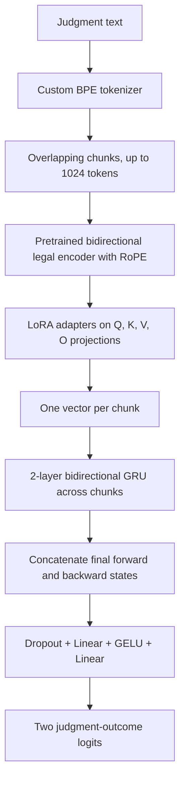

# Phase 4 – Court Judgment Prediction (CJPE)

For Phase 4, I worked on predicting the outcome of a court judgment from its text. This is a **binary classification** task, so the model predicts either label `0` or `1` for each case. Judgments are long, and feeding only the first 1,024 tokens would leave out much of the text. I used chunks and a hierarchical classifier to combine information from different parts of the judgment.

**Best model code:** The code for my best-performing Phase 4 model, **Hybrid encoder + LoRA (Q/K/V/O) + BiGRU**, is present in `phase4-hybrid-lorma (2).ipynb`. Although the filename says `lorma`, the active best-model construction in this notebook uses `LoraModel` and `HierarchicalLoraCJP`.

## Model architecture



The backbone is initialized from the earlier hybrid-encoder checkpoint. In the best-model configuration, it has **10 encoder layers**, hidden size **512**, **8 attention heads**, **8 key/value heads**, feed-forward size **4096**, and **RoPE** positional encoding. The model uses rank **16** LoRA adapters with scaling alpha **32** and dropout **0.05** on the attention projections `q_proj`, `k_proj`, `v_proj`, and `o_proj`. The original pretrained backbone weights are frozen by `LoraModel`; the LoRA parameters and downstream classifier are trainable.

Each document is processed as a sequence of chunk vectors. A **two-layer bidirectional GRU**, with hidden size **256** in each direction, combines those vectors. The final forward and backward states are concatenated into a 512-dimensional document representation. A classifier with dropout and GELU produces two logits. The active `HierarchicalLoraCJP.forward` encodes chunks in small internal batches to reduce memory use.

## Methodology and preprocessing

1. I loaded the training, development and test JSON files from the `Exploration-Lab/CS-781-Capstone` Hugging Face dataset repository.
2. I removed duplicate training and development rows and saved the cleaned data to `train_deduplicated.json` and `dev_deduplicated.json`.
3. I used the custom BPE tokenizer from the earlier phases. Token sequences are split into overlapping chunks, with beginning/end tokens added to each chunk.
4. I used a pretrained legal-text encoder to represent each chunk and passed the ordered chunk vectors to the BiGRU.
5. I trained the classifier using cross-entropy and checked validation accuracy and Macro-F1. For the final prediction file, I applied a probability threshold to the positive class.

### Important preprocessing settings

| Setting | Notebook value |
|---|---:|
| Maximum chunk length | 1,024 tokens, including start/end tokens |
| Chunk overlap | 64 tokens |
| Maximum training/validation chunks | 32 |
| Maximum test chunks in the prediction cell | 16 |
| Training batch size | 2 documents |
| Validation batch size | 2 documents |
| Optimizer | AdamW |
| LoRA learning rate | `5e-5` |
| BiGRU/classifier learning rate | `3e-4` |
| Weight decay | `0.01` |
| Loss | Cross-entropy |
| Training epochs in the active run | 3 |
| Test probability threshold | `0.5` |
| Seed | `42` |

**Note on dataset counts:** The training output of the best-model notebook reports **32,305** deduplicated training rows and **2,511** development rows. Other experiment notebooks in this ZIP report **994** development rows, so their validation results should not be compared as if they used identical evaluation sets.

## Experiments and results

I tried the following Phase 4 approaches. The filenames below are kept exactly as they appear in the uploaded folder.

| Notebook | Experiment |
|---|---|
| `phase4-hybrid-lorma (2).ipynb` | **Best-model notebook:** hybrid encoder with Q/K/V/O LoRA adapters and hierarchical BiGRU |
| `decoder-phase4 (2).ipynb` | Decoder-backbone experiment with a hierarchical judgment classifier |
| `encoder-decoder-p4 (2).ipynb` | Encoder–decoder backbone experiment |
| `kerenel-phase4 (1).ipynb` | Kernel adaptation experiment |
| `knowledge-distillation-p4 (1).ipynb` | Teacher–student knowledge-distillation experiment |

In the saved output of the best-model notebook, validation Macro-F1 increases across the three epochs: **0.7226 → 0.7503 → 0.7513**. A separate threshold sweep printed in that notebook reaches **0.7537** Macro-F1 at threshold `0.30`. The test prediction cell, however, uses threshold `0.5`.

**Best official Codabench result:** Macro-F1 **0.767635**, rank **32**, submission ID **1008086**. This is an official submission result, not the notebook's internal validation score. The notebook alone does not establish that every saved cell matches the final submitted checkpoint.

## How to run the code

The notebooks were written for a **Kaggle GPU environment**. They use Kaggle secrets for the Hugging Face access token and several `/kaggle/input/...` paths. The ZIP does **not** include pretrained model weights or checkpoints, in line with the course submission rules.

1. Create a Kaggle notebook with a GPU and install or enable the required Python libraries: `torch`, `numpy`, `pandas`, `scikit-learn`, `tqdm`, `huggingface_hub`, `ipython`, and `kaggle_secrets` (provided by Kaggle).
2. Set the Kaggle secret named `HF` if the dataset requires authentication. Check that you can access `Exploration-Lab/CS-781-Capstone`.
3. Provide the **custom BPE tokenizer** and the **pretrained hybrid-encoder checkpoint** externally. Update the tokenizer and checkpoint paths in `phase4-hybrid-lorma (2).ipynb` to your actual Kaggle inputs. No weights are provided in this submission archive.
4. Run the data download and deduplication cells first, then the tokenizer, dataset, model-definition, and model-initialization cells.
5. **Choose training or inference deliberately:** the current notebook also contains a cell that reloads an intermediate Phase 4 checkpoint (`best_hierarchical_lora_cjp_3.pt`) before configuring the optimizer. To train from scratch on the pretrained encoder, skip or adapt that reload cell, then run the training loop. To reproduce continuation/inference from that state, supply the external Phase 4 checkpoint.
6. For inference, update the test input paths and run the test DataLoader and prediction cells to write `submission.json`.
7. **Check the final export cell before submitting:** the notebook creates `submission.json`, but its ZIP-writing cell refers to `PREDICTION_PATH`, a separate `prediction.json` path. Point the export at the actual predictions file and follow the current Codabench JSON/ZIP format.

These are **execution instructions**, not a claim that the supplied notebook will run end-to-end without configuring the external files and the checkpoint-dependent cells.

## Files in this folder

```text
phase4/
├── README.md
├── phase4-hybrid-lorma (2).ipynb       # Best-model implementation
├── decoder-phase4 (2).ipynb            # Decoder experiment
├── encoder-decoder-p4 (2).ipynb        # Encoder–decoder experiment
├── kerenel-phase4 (1).ipynb            # Kernel experiment
└── knowledge-distillation-p4 (1).ipynb # Distillation experiment
```

I have kept the experimental notebooks so it is easier to see the approaches I compared. **For the course's final `code/phase4/` folder, the main best-model implementation is `phase4-hybrid-lorma (2).ipynb`**, together with this README and any non-weight supporting source/config files needed for the run. Checkpoints and model weights should not be included.

