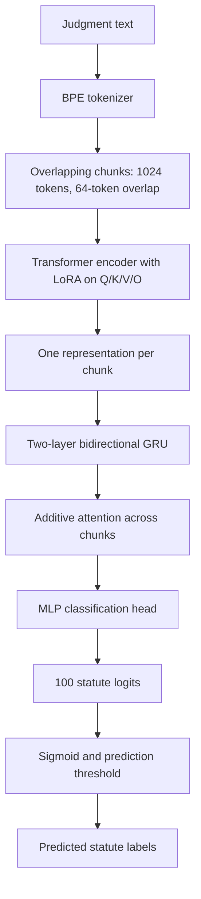

# Phase 5 — Legal Statute Identification

## Overview

In Phase 5, I worked on **Legal Statute Identification (LSI)**. Given a court judgment, the model predicts which statute labels apply to it. This is a **multi-label classification** problem: one judgment can have more than one correct label.

I used the legal-language models developed in the earlier phases and compared different ways of adapting them for long judgments. My best official result was from an **encoder with LoRA adapters, followed by a BiGRU and an attention-based classification head**.

**Best model code:** The encoder LoRA + BiGRU attention implementation is in [`encoder-decoder-p5.ipynb`](encoder-decoder-p5.ipynb). Although the filename says *encoder-decoder*, the downstream classification code takes the **encoder** from an encoder–decoder backbone. The other notebooks contain the alternative experiments.

## Model architecture

A judgment may be longer than the encoder's context window, so I split it into overlapping chunks. The same encoder processes each chunk. I then combine the chunk representations to predict the document-level statute labels.

In the main notebook, the encoder comes from an `EncoderDecoderTransformer` with RoPE. The LoRA wrapper uses rank **16**, alpha **32**, and dropout **0.05** on the query, key, value, and output projections. The document-level head uses a **two-layer BiGRU** with hidden size **256**, additive attention, and an MLP to produce **100 logits**. This is the architecture used in the active classifier code, rather than a text-generation decoder.

## Methodology and preprocessing

1. I load the Phase 5 training and development JSON files from the course dataset repository (`Exploration-Lab/CS-781-Capstone`).
2. I remove duplicate records before constructing the datasets.
3. I load the existing BPE tokenizer saved as `project_bpe_16k.pkl` in the Kaggle environment.
4. I tokenize the judgment and create chunks of up to **1,024 tokens**, with **64 overlapping content tokens**. The main notebook limits each document to **16 chunks**.
5. I convert the statute IDs into a **100-dimensional multi-hot target vector**. A label is `1` when that statute applies to the judgment.
6. I train with `BCEWithLogitsLoss`, since several statutes may be predicted for the same judgment.

The chunk cap means very long judgments can be truncated; the implementation does not necessarily use every token of every judgment.

## Implementation and training

The main notebook is written in **Python and PyTorch**. Its training code uses mixed precision when CUDA is available, gradient clipping at **1.0**, and AdamW. The code keeps separate learning rates for the LoRA parameters and the classification head.

| Setting | Value in `encoder-decoder-p5.ipynb` |
|---|---|
| Tokenizer | BPE artifact loaded from Kaggle input |
| Context per chunk | 1,024 tokens |
| Chunk overlap | 64 tokens |
| Maximum chunks | 16 |
| Number of labels | 100 |
| LoRA | Q/K/V/O; rank 16; alpha 32; dropout 0.05 |
| BiGRU | 2 layers; 256 hidden units per direction |
| Training batch size | 2 |
| Optimizer | AdamW, weight decay 0.01 |
| LoRA learning rate | 2e-4 |
| Classification-head learning rate | 1e-3 |
| Loss | BCEWithLogitsLoss |
| Training epochs | 5 |
| Hardware | CUDA GPU recommended; multi-GPU support appears in notebook |

Training and prediction thresholds are separate choices. The notebooks evaluate multiple cutoffs because using `0.5` by default can miss positive labels in an imbalanced multi-label task. The **official best submission used a threshold of 0.35**, as recorded in my Phase 5 results; this does not mean every notebook cell evaluates at that threshold.

## Experiments

I tried several backbones and adaptation methods. These are the notebooks in this folder:

| Notebook | Experiment |
|---|---|
| [`encoder-decoder-p5.ipynb`](encoder-decoder-p5.ipynb) | **Best-model architecture:** encoder LoRA + BiGRU + attention, using the encoder from an encoder–decoder backbone |
| [`decoder-phase5.ipynb`](decoder-phase5.ipynb) | Decoder-based backbone and hierarchical attention classifier; this notebook uses a LoRMA wrapper |
| [`hybrid-attention-p5 (2).ipynb`](hybrid-attention-p5%20%282%29.ipynb) | Frozen-backbone hierarchical BiGRU + attention experiment; the active training code does not use the commented-out LoRA classifier |
| [`kernel-phase5.ipynb`](kernel-phase5.ipynb) | Kernel-attention backbone with LoRA and hierarchical classifier |
| [`knowledge-distillation-p5.ipynb`](knowledge-distillation-p5.ipynb) | Teacher–student knowledge-distillation experiment |

Some experiment filenames describe the general model family and do not fully identify which class was active in training. I used the active model construction in each notebook for the descriptions above.

### Best official Phase 5 result

| Metric | Score |
|---|---:|
| **Macro-F1** | **0.351363** |
| Micro-F1 | 0.484613 |
| Exact-set accuracy | 0.042246 |
| Codabench rank | 87 |
| Best submission ID | 1014922 |

These are **official Codabench scores**, not the local validation results printed by the notebooks. The notebook files alone do not provide a direct ID-to-file trace for the winning submission.

A key difficulty in this phase was class imbalance. Some statutes appear in many cases while others are rare. Long documents are also harder to handle because only a limited number of chunks can be passed to the model.

## How to run

The notebooks were developed for **Kaggle** and contain Kaggle-specific input paths. They are not completely standalone: you must provide the course data, the saved BPE tokenizer, and any required pretrained backbone initialization. Model weights and checkpoints are **not included** in this repository, as required for the course submission.

1. Open [`encoder-decoder-p5.ipynb`](encoder-decoder-p5.ipynb) in Kaggle (or another CUDA-enabled Jupyter environment).
2. Install the required Python packages if they are not already available: `torch`, `numpy`, `pandas`, `scikit-learn`, `tqdm`, `huggingface_hub`, and the notebook environment's supporting packages.
3. Make the Phase 5 dataset accessible. The notebook downloads `Phase_5_LSI/Train/train.json` and `Phase_5_LSI/Train/dev.json` using Hugging Face Hub. Set up the dataset access token **through environment secrets**, not in source control.
4. Attach the BPE tokenizer artifact and update the `bpe_path` variable to its actual location.
5. Supply the pretrained model checkpoint expected by the notebook, updating its original Kaggle path. The checkpoint is a **runtime prerequisite**, not a file to upload in the final ZIP.
6. Run the notebook cells in order: data loading → deduplication → tokenizer and chunking → architecture setup → pretrained weight loading → model training → validation → prediction generation.
7. For an official submission, use the required prediction JSON/ZIP format from the Phase 5 course evaluator and the verified best prediction threshold.
