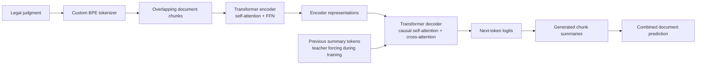

# Phase 6 — Legal Judgment Summarization

For Phase 6, I trained models to generate shorter summaries of legal judgments. The input is a judgment document and the output is its summary. I tried decoder-only, encoder–decoder, hybrid, kernel-attention, and knowledge-distillation approaches. My best **official Codabench submission** used an **encoder–decoder Transformer with full fine-tuning**.

## Best model code

The best-model code is in **[`phase6-encoderdecoder-fullfinetuning.ipynb`](phase6-encoderdecoder-fullfinetuning.ipynb)**. It contains the encoder–decoder architecture, data loading, chunk-level alignment, full fine-tuning, validation, and prediction generation. The earlier encoder–decoder LoRA experiment is in [`encoder-decoder-p6 (2).ipynb`](encoder-decoder-p6%20%282%29.ipynb).

## 1. Model architecture

I used an encoder–decoder Transformer. The encoder reads a judgment chunk using bidirectional self-attention. The decoder predicts the summary tokens autoregressively using masked self-attention and **cross-attention to the encoder output**. In the best experiment, I updated **all original encoder and decoder parameters**, not LoRA adapters.

The model uses the Phase 1 project tokenizer and a pretrained encoder–decoder initialization, loaded from the external files referenced in the notebook. The active full-fine-tuning run reports **77,486,080 total and trainable parameters**. The notebook config uses an **8,000-token vocabulary**, model width **512**, **6 layers** in each encoder/decoder stack, **8 attention heads**, and model context length **1,024**. Some early configuration cells also contain settings reused from other experiments; the final model-building and training cells determine the active run.

## 2. Dataset and methodology

- **Dataset:** the course's Phase 6 judgment–summary pairs, accessed through the Kaggle/Hugging Face data setup in the notebooks.
- I use a **custom BPE tokenizer** and split long judgments into overlapping token chunks so they fit the model's context limit.
- The code aligns summary sentences with document chunks using text embeddings and cosine similarity. This creates chunk-level training targets from the document-level summaries.
- The executed full-fine-tuning notebook loads an existing `train_chunk_aligned.json`, rather than computing all alignments again during training.
- The active encoder–decoder dataset creates separate **source token IDs**, **decoder input IDs**, and **target labels**. The decoder is trained by teacher forcing to predict the next token. Padding positions are excluded from the loss.
- The notebook shows **6,970 aligned documents**, split into **6,273 training** and **697 validation** documents with a 10% held-out split and random seed 42.

The chunking code uses a source length of **768 tokens**, **128 tokens of overlap**, and a cap of **20 chunks** at document inference. Each aligned source chunk has a corresponding target summary segment; empty target chunks are skipped in training.

## 3. Implementation and training

The best-model implementation is in PyTorch. The encoder and decoder are built from the notebook's own `EncoderLM`, `DecoderLM`, and `EncoderDecoderTransformer` classes. The `FullFineTuneEncoderDecoder` wrapper enables gradient updates for every model parameter.

| Setting | Best full-fine-tuning run |
| --- | --- |
| Trainable parameters | 77,486,080 / 77,486,080 |
| Optimizer | AdamW |
| Learning rate | `2e-4` |
| Weight decay | `0.01` |
| Training batch size | `8` |
| Epochs | `10` |
| Random seed | `42` |
| Validation split | 10% |
| Precision | CUDA automatic mixed precision (FP16) where available |
| Gradient clipping | Maximum norm `1.0` |
| Hardware shown in saved outputs | 2 × NVIDIA Tesla T4 GPUs |

Training uses next-token cross-entropy on the target summary tokens. After each epoch, I checked validation loss and saved the best checkpoint during training. The best validation loss in the saved notebook output was **3.103317 at epoch 8** (out of 10). The model was restored from that epoch for prediction generation.

**Note on notebook history:** The opening Markdown of the full-fine-tuning notebook still describes the experiment as *unexecuted*, because it was written before training. Its saved cell outputs contain the later completed 10-epoch training run, including the epoch-8 best-checkpoint restoration. The recorded outputs are the basis for the training details above.

## 4. Experiments and results

| Notebook | Experiment |
| --- | --- |
| `decoder-phase6 (1).ipynb` | Decoder-only summarization with LoRA |
| `encoder-decoder-p6 (2).ipynb` | Encoder–decoder summarization with LoRA |
| `encoder-decoder-p6-kd (1).ipynb` | Encoder–decoder knowledge distillation |
| `hybrid-encoder-p6 (1).ipynb` | Hybrid encoder/decoder adaptation |
| `kernel-phase6.ipynb` | Kernel-attention variant |
| **`phase6-encoderdecoder-fullfinetuning.ipynb`** | **Best official approach: full encoder–decoder fine-tuning** |

### Best official Codabench result

| Metric | Score |
| --- | ---: |
| **BERTScore F1** (primary) | **0.823633** |
| ROUGE-1 | 0.464177 |
| ROUGE-L | 0.191465 |
| Codabench rank | 113 |
| Submission ID | `1043776` |

The earlier encoder–decoder LoRA submission obtained **BERTScore F1 = 0.819982**. Full fine-tuning improved the official primary score slightly. These **Codabench scores** are separate from the local validation-loss measurements in the notebook.

## 5. How to run the code

The notebooks were written for **Kaggle with GPU enabled**. They are not completely self-contained because they read pretrained model/tokenizer files and dataset artifacts from `/kaggle/input/...` paths. You need to attach those datasets in your environment or update the paths before running.

1. Open `phase6-encoderdecoder-fullfinetuning.ipynb` in a Kaggle GPU notebook (the saved run used two T4 GPUs).
2. Make the **Phase 6 train/test JSON files** available at the paths expected in the notebook. The data-loading code refers to `Phase_6_Summ/Train/train.json` and `Phase_6_Summ/Test/test.json`.
3. Attach the **custom project BPE tokenizer** (`project_bpe_16k.pkl`, as named in the notebook), the pretrained encoder–decoder initialization (`encoder_decoder_final.pt`), and the **aligned training file** (`train_chunk_aligned.json`). These are **runtime inputs**, not included in this submission ZIP.
4. Update hard-coded `/kaggle/input/...` dataset paths if your attached dataset names differ.
5. Run the notebook cells **in order**, including imports, tokenizer loading, preprocessing/data inspection, architecture classes, data loaders, full-fine-tuning setup, training, and generation.
6. Use the best-validation checkpoint generated **by your run** when executing the final prediction cells. Check the expected prediction JSON schema before uploading to Codabench.

