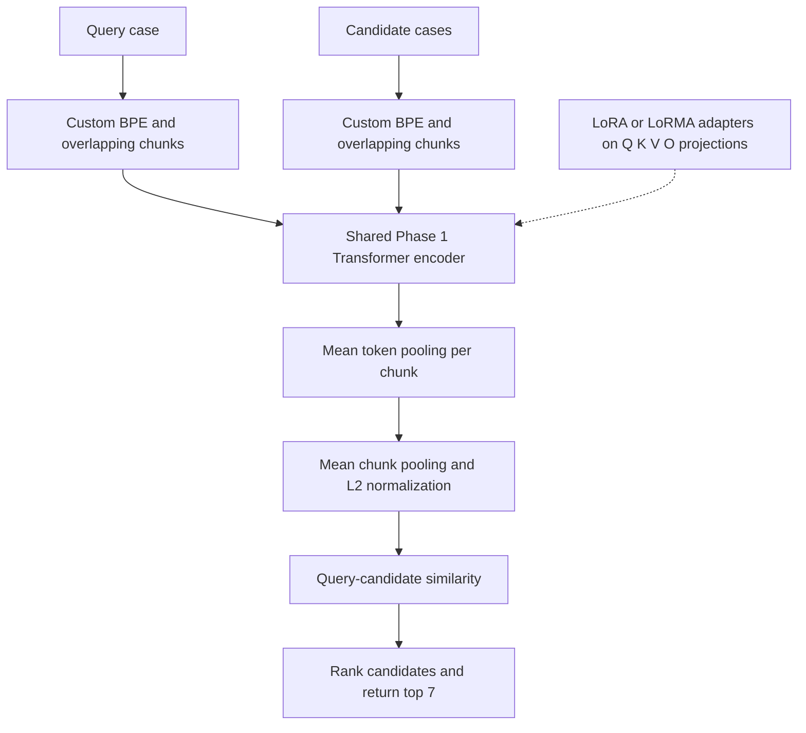

# Phase 7 — Prior Case Retrieval

In Phase 7, I worked on **prior case retrieval**. Given a legal case as a query, the model ranks the candidate cases and returns the **top seven** most relevant cases. I used the pretrained Phase 1 encoder as a starting point and compared full fine-tuning, LoRA-based adaptation, encoder–decoder retrieval, decoder models, linear attention, and knowledge distillation.

My **best official Codabench submission** was the **Hybrid LoRA+** approach, with **Micro-F1@7 = 0.255759** (submission `1037946`, rank **112**). The supplied ZIP has related retrieval experiments, but **I have not matched an exact notebook in this ZIP to that official winning submission**. In particular, the `LoRMA+` notebook is not the same implementation as ordinary `LoRA+`. That difference is important when selecting the code for the final best-model-only submission.

## Best-model code and notebook references

The closest documented parameter-efficient encoder experiments are:

- [`pcr-experiment-3-lora-random-negatives.ipynb`](pcr-experiment-3-lora-random-negatives.ipynb) — standard **encoder LoRA** with random negatives and hierarchical pooling.
- [`pcr-experiment-3-lorma-random-negatives-complete.ipynb`](pcr-experiment-3-lorma-random-negatives-complete.ipynb) — **encoder LoRMA+**, using a different adapter formula and separate learning rates for its A and B matrices. This is the strongest saved *local validation* result in the uploaded archive.
- [`hybrid-p7 (2).ipynb`](hybrid-p7%20%282%29.ipynb) — full backbone fine-tuning using the Phase 1 encoder and hierarchical pooling.

**Best official result:** Hybrid LoRA+ (Micro-F1@7 `0.255759`). **Best saved validation result in this archive:** encoder LoRMA+ (Micro-F1@7 `0.287938`). These are different model variants and different evaluation sets. The archive alone does not prove which notebook produced official submission `1037946`.

## 1. Model architecture

The encoder-based retrieval experiments use a Transformer initialized with the pretrained Phase 1 encoder. The encoder has a **512-dimensional hidden representation**, **10 layers**, **8 attention heads**, **RoPE positional embeddings**, and a maximum token length of **1,024**. For long case documents, the code creates overlapping chunks and limits each document to eight chunks.

For the LoRA and LoRMA variants, the base Transformer parameters are frozen while low-rank matrices are inserted into the attention projections. The model then forms one embedding for each document:

1. Encode each chunk with the Transformer.
2. Average the non-padding token hidden states within that chunk.
3. Average the chunk embeddings to obtain a document embedding.
4. L2-normalize the document embedding.
5. Compare a query embedding with candidate embeddings using dot-product similarity and return the top seven scores.

The diagram illustrates the shared encoder retrieval pipeline used by the encoder-adapter notebooks. It does not claim that every alternative notebook uses the same architecture: decoder, linear-attention, and encoder–decoder experiments are separate implementations.

**Adapter distinction in the code:**

- Standard LoRA uses an additive update on the **input**, `W(x) + (alpha/r) B(A(x))`.
- The supplied LoRMA+ notebook instead applies its low-rank update to the **base projection output**, `W(x) + (alpha/r) B(A(W(x)))`. It trains A and B with separate learning rates. These formulas should not be treated as interchangeable.

## 2. Dataset and methodology

I used the course **Phase 7 PCR** dataset. The notebook loads separate JSON files for queries and candidate cases in each split:

| Split | Queries | Candidate cases |
| --- | ---: | ---: |
| Train | 827 | 4,320 |
| Development | 118 | 1,023 |
| Test | 237 | 1,727 |

In training and development, query records include `relevant_candidates`. The code converts the input text into token IDs using the custom BPE tokenizer and builds chunks with **1,024 total positions**, **64 tokens of overlap**, and at most **8 chunks per case**. Padding and special-token positions are handled by the notebook.

During training, I used all available positive candidates for a query together with **four randomly sampled negative candidates**. The loss is a **multi-positive contrastive objective**, with temperature `0.07`: it increases the scores assigned to positive cases relative to the other sampled candidates. The code does not use TF-IDF hard-negative mining in the main encoder experiments.

During development evaluation, the code encodes the **full development candidate pool** and computes Micro-Precision@7, Micro-Recall@7, and Micro-F1@7 instead of evaluating against only the training negatives.

## 3. Implementation and experimental setup

The implementations use **PyTorch**. The main encoder experiments also use **Hugging Face Hub** for dataset download, a saved custom BPE tokenizer, and a pretrained Phase 1 encoder checkpoint supplied separately at runtime. The checkpoint is used as an initialization; **it is not part of this code archive**.

The following parameters come from the executed `pcr-experiment-3-lorma-random-negatives-complete.ipynb` cells and describe **that LoRMA+ experiment**, not a verified configuration for the winning official Hybrid LoRA+ submission:

| Setting | LoRMA+ encoder experiment |
| --- | --- |
| Random seed | `42` |
| Max token positions | `1024` |
| Chunk overlap | `64` |
| Max chunks per document | `8` |
| Chunk micro-batch size | `8` |
| Query batch size | `8` |
| Random negatives per query | `4` |
| Adapter rank / alpha / dropout | `16` / `32` / `0.05` |
| Optimizer | AdamW |
| Learning rate for A | `2e-5` |
| Learning rate for B | `3.2e-4` (16× A) |
| Weight decay | `0.01` |
| Contrastive temperature | `0.07` |
| Gradient clipping | `1.0` |
| Mixed precision | CUDA automatic mixed precision |
| Model initialization | Pretrained Phase 1 encoder |

The notebook's configuration initially contains `EPOCHS = 5` and later updates the training setup; its saved output records completed training and a best checkpoint. For exact reproduction, follow the executed code sequence rather than assuming the first configuration cell is final. The code uses memory-saving chunk micro-batches and gradient checkpointing where configured.

## 4. Experiments and results

| Notebook | Experiment |
| --- | --- |
| `hybrid-p7 (2).ipynb` | Phase 1 encoder with full fine-tuning and hierarchical mean pooling |
| `pcr-experiment-3-lora-random-negatives.ipynb` | Phase 1 encoder with standard LoRA |
| `pcr-experiment-3-lorma-random-negatives-complete.ipynb` | Phase 1 encoder with LoRMA+ and separate A/B learning rates |
| `pcr-encoderdecoder-mha-lora-random-negatives.ipynb` | Encoder–decoder MHA model with LoRA |
| `pcr-lora-random-negatives-decoder-mha (3).ipynb` | Decoder-only MHA model with LoRA |
| `kernel-decoder-p7 (1).ipynb` | Linear-attention decoder with LoRA |
| `pcr-linearattention-lora-kd-random-negatives-full.ipynb` | Linear-attention student trained using knowledge distillation |

### Official best Codabench submission

| Metric | Official score |
| --- | ---: |
| **Micro-F1@7** (primary) | **0.255759** |
| Micro-Precision@7 | 0.261001 |
| Micro-Recall@7 | 0.250724 |
| Rank | **112** |
| Submission ID | `1037946` |

### Selected saved development-set results

| Notebook variant | Best local Micro-F1@7 |
| --- | ---: |
| Full-fine-tuned encoder (`hybrid-p7`) | 0.286826 |
| Encoder LoRA | 0.273485 |
| **Encoder LoRMA+** | **0.287938** |
| Encoder–decoder LoRA | 0.114508 |
| Decoder-only MHA LoRA | 0.231240 |
| Linear-attention knowledge distillation | 0.101167 |

These numbers come from the saved notebook outputs and measure performance **on the local development split**. They should not be compared as if they were official Codabench test scores. Some runs also use different training configurations, so differences cannot be attributed to one component without a controlled experiment.

## 5. How to run the code

These notebooks were written for **Kaggle with GPU enabled**, and several file paths are Kaggle-specific.

1. Open the notebook corresponding to the experiment. For the documented encoder LoRMA+ experiment, use `pcr-experiment-3-lorma-random-negatives-complete.ipynb`; for standard encoder LoRA, use `pcr-experiment-3-lora-random-negatives.ipynb`.
2. Provide the course data from the `Exploration-Lab/CS-781-Capstone` Hugging Face dataset repository. The relevant files are `Phase_7_PCR/Train/train.json`, `train_candidates.json`, and the corresponding `Dev/` and `Test/` files.
3. Configure a Hugging Face access token under the Kaggle secret name **`HF`**, if authentication is needed for the dataset. Do not add credentials to the GitHub repository.
4. Attach the custom tokenizer file named `project_bpe_16k.pkl` in the notebook and the pretrained `hybrid_encoder.pt` Phase 1 encoder initialization. **These external artifacts are not included in this ZIP.** Update `BPE_PATH` and `PHASE1_CHECKPOINT` for your Kaggle dataset attachment names.
5. Run the notebook from top to bottom: imports, data loading, tokenizer, preprocessing, encoder initialization, adapter setup, training, development evaluation, and test predictions.
6. The notebook saves a best checkpoint during training and reloads it for evaluation. Use only checkpoints **created by your own run**; no trained weights are submitted here.
7. Check the top-seven prediction output and required Codabench submission JSON format before uploading predictions. Different notebooks save test predictions under different output paths and formats.

